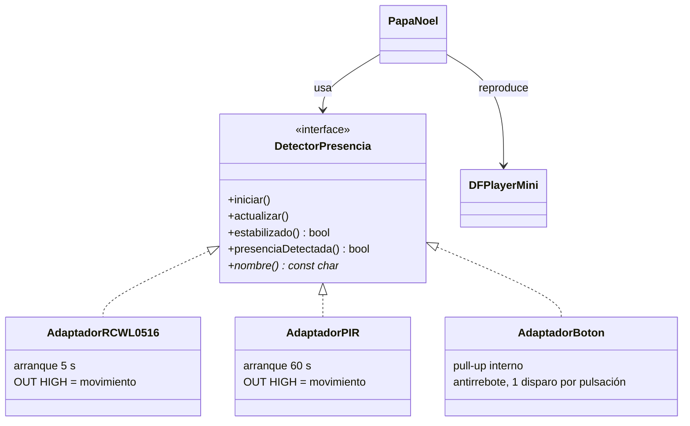

# 🎅 Papá Noel parlante con detector de presencia

## Introducción

Este proyecto le pone voz a un muñeco de Papá Noel. Cada vez que mi sobrino pasa por delante, el muñeco lo detecta y le dice una frase aleatoria y personalizada con la voz de Papá Noel: lo saluda por su nombre, le pregunta si se ha portado bien, se ríe con su "¡Jo, jo, jo!"...

Todo funciona con un **ESP32**, un reproductor MP3 **DFPlayer Mini** que lee los audios de una **microSD**, un pequeño altavoz y un **detector de presencia** intercambiable: un radar **RCWL-0516**, un sensor **PIR** o, para hacer pruebas, un simple **pulsador**.

## Características

- Reproduce un audio aleatorio de la microSD cada vez que detecta a alguien, sin repetir el anterior.
- Espera un tiempo configurable entre reproducciones (45 s por defecto) para no repetirse sin parar.
- Ignora el sensor mientras suena un audio y durante unos segundos después, para evitar falsos disparos.
- La detección de presencia está **desacoplada** del resto del firmware mediante el **patrón Adapter**: cambiar de sensor es cambiar una línea.

## Hardware

| Componente | Función |
|---|---|
| ESP32 DevKit | Microcontrolador |
| DFPlayer Mini | Reproductor MP3 con ranura microSD y amplificador de 3 W integrado |
| Altavoz de 3 W, 4 a 8 Ω | Salida de sonido |
| microSD (FAT32, hasta 32 GB) | Almacena los audios |
| Resistencia de 1 kΩ | Protege la línea RX del DFPlayer |
| Detector de presencia: RCWL-0516, PIR HC-SR501 o pulsador | Activa la reproducción |
| Fuente USB de 5 V, 1 A o más | Alimentación |
| Condensador de 470 a 1000 µF (opcional) | Estabiliza la alimentación del DFPlayer |

## Diseño del firmware

```
papa_noel_detector_presencia/
├── papa_noel_detector_presencia.ino   Programa principal
├── DetectorPresencia.h                Interfaz común de los detectores
├── AdaptadorRCWL0516.h                Adaptador del radar RCWL-0516
├── AdaptadorPIR.h                     Adaptador del PIR HC-SR501
└── AdaptadorBoton.h                   Adaptador de un pulsador (pruebas)
```

### Patrón Adapter

El programa principal no sabe qué sensor hay conectado. Solo habla con la interfaz `DetectorPresencia`, y cada sensor tiene un adaptador que traduce su forma concreta de funcionar (nivel de la señal, tiempo de estabilización, antirrebote...) a esa interfaz común.



| Método | Para qué sirve |
|---|---|
| `iniciar()` | Configura pines o buses. Se llama una vez en `setup()`. |
| `actualizar()` | Se llama en cada vuelta de `loop()`. Útil para sensores que leen un bus (UART, I2C) o filtran la señal. Por defecto no hace nada. |
| `estabilizado()` | Indica si el sensor ya da lecturas fiables (el PIR necesita alrededor de un minuto tras encender). |
| `presenciaDetectada()` | `true` si hay alguien delante. |
| `nombre()` | Nombre del sensor para el Monitor Serie. |

### Elegir el detector

En `papa_noel_detector_presencia.ino` solo hay que dejar descomentada una línea:

```cpp
// ---------------- DETECTOR ---------------
AdaptadorRCWL0516 adaptador(PIN_DETECTOR);
// AdaptadorPIR      adaptador(PIN_DETECTOR);
// AdaptadorBoton    adaptador(PIN_DETECTOR);

DetectorPresencia& detector = adaptador;  // a partir de aquí solo se usa la interfaz
```

### Añadir un sensor nuevo

Basta con crear un archivo `AdaptadorXxx.h` que herede de `DetectorPresencia`:

```cpp
#pragma once
#include <Arduino.h>
#include "DetectorPresencia.h"

class AdaptadorXxx : public DetectorPresencia {
public:
  explicit AdaptadorXxx(int pin) : pin_(pin) {}
  void iniciar() override             { pinMode(pin_, INPUT); }
  bool presenciaDetectada() override  { return digitalRead(pin_) == HIGH; }
  const char* nombre() const override { return "Mi sensor"; }
private:
  int pin_;
};
```

Después se incluye en el `.ino` y se crea el adaptador en la sección `DETECTOR`. El resto del programa no cambia.

### Lógica principal

1. Al arrancar, inicializa el detector y el DFPlayer (con reintentos). Si el DFPlayer no responde, el LED integrado parpadea rápido.
2. En cada vuelta de `loop()` llama a `detector.actualizar()` y espera a que `detector.estabilizado()` sea `true`.
3. Si `presenciaDetectada()` es `true`, no está sonando nada (pin `BUSY` del DFPlayer), ha pasado el tiempo de espera y no acaba de terminar otro audio, elige un número aleatorio distinto del anterior y reproduce `/mp3/000N.mp3`.

### Parámetros configurables

| Constante | Por defecto | Descripción |
|---|---|---|
| `NUM_AUDIOS` | `12` | Número de archivos en la carpeta `/mp3` de la microSD |
| `VOLUMEN` | `18` | Volumen del DFPlayer, de 0 a 30 |
| `ESPERA_MS` | `45000` | Tiempo mínimo entre reproducciones, en ms |
| `TRAS_AUDIO_MS` | `3000` | Tiempo que se ignora el detector tras acabar un audio, en ms |
| `PIN_DETECTOR` | `27` | Entrada del detector de presencia |

## Audios en la microSD

1. Formatea la microSD en **FAT32**.
2. Crea en la raíz una carpeta llamada **`mp3`**.
3. Copia los audios con nombres de **4 cifras**, empezando por `0001`:

```
microSD/
└── mp3/
    ├── 0001.mp3
    ├── 0002.mp3
    ├── 0003.mp3
    └── ...
```

4. Ajusta `NUM_AUDIOS` en el sketch al número de archivos.

Conviene copiar los archivos en orden y no dejar otros archivos en la carpeta. Si un audio se corta al principio, añadirle medio segundo de silencio inicial suele solucionarlo.

### La voz de Papá Noel

Los audios con la voz de Papá Noel los generé con el generador de voz de Santa de [AnyToSpeech](https://anytospeech.com/es/ai-voice-generator/santa): se escribe la frase, se genera y se descarga en MP3. Así es fácil personalizar las frases con el nombre del niño. Por ejemplo:

- "¡Jo, jo, jo! ¡Hola, [nombre]! ¡Feliz Navidad!"
- "¿Has sido un niño muy bueno este año?"
- "¡Mis renos y yo ya estamos preparando los regalos!"

## Esquema de conexiones


| ESP32 | Conecta a |
|---|---|
| 5V / VIN | VCC del DFPlayer y VCC/VIN del sensor |
| GND | GND del DFPlayer y GND del sensor |
| GPIO17 (TX2) | RX del DFPlayer **a través de una resistencia de 1 kΩ** |
| GPIO16 (RX2) | TX del DFPlayer |
| GPIO26 | BUSY del DFPlayer (LOW mientras suena) |
| **GPIO27** | **Salida del detector de presencia** |

El altavoz se conecta directamente a **SPK1** y **SPK2** del DFPlayer (no a GND).

### El pin 27: entrada del detector

`GPIO27` es la única conexión que depende del detector elegido, y puede ser:

- **Radar RCWL-0516**: su pin **OUT** va al GPIO27, **VIN** a 5V y **GND** a GND. Los pines 3V3 y CDS se dejan sin conectar. La salida es de 3,3 V, así que es segura para el ESP32. Ojo: detecta a través de plástico, tela y paredes finas, con un alcance de 5 a 7 m.
- **PIR HC-SR501**: su pin **OUT** va al GPIO27, **VCC** a 5V y **GND** a GND. Su salida también es de 3,3 V. Se recomienda poner el puente en modo H y el tiempo al mínimo.
- **Pulsador**: entre el **GPIO27** y **GND**, sin resistencia, porque el firmware usa el pull-up interno del ESP32.

En todos los casos se usa el mismo pin, así que cambiar de detector es cambiar el cableado de ese sensor y la línea correspondiente en la sección `DETECTOR` del sketch.

## Compilar y cargar

1. Instala en Arduino IDE el soporte de placas **esp32** de Espressif.
2. Instala la librería **DFRobotDFPlayerMini** desde el Gestor de librerías.
3. Abre `papa_noel_detector_presencia/papa_noel_detector_presencia.ino`. La carpeta y el `.ino` deben llamarse igual.
4. Selecciona la placa **ESP32 Dev Module** y el puerto, y carga el sketch.
5. Abre el Monitor Serie a **115200** baudios para ver qué detecta y qué reproduce.

## Seguridad

El muñeco es para un niño pequeño, así que toda la electrónica va dentro de una caja cerrada y atornillada, sin piezas pequeñas ni pilas accesibles. Se alimenta con un cargador USB con el cable fuera de su alcance, y el volumen se mantiene moderado.
